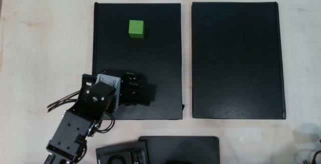
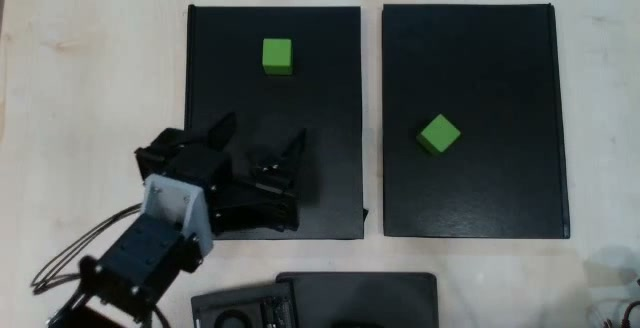

# Practice Makes Fluent

Learning to Use Earlier Predictions in Looped Models

Minseok Seo†, Hee-Seon Kim†, and Changick Kim  
School of Electrical Engineering, KAIST  
† Equal contribution

[Read the paper](paper.pdf)

## Robot comparison

The first-day recording lasts 57.3 seconds and the last-day recording lasts 29.2 seconds. The two runs show a robot moving the same two green blocks from the left tray to the right. Both clips retain their original timing.

| First day | Last day |
| --- | --- |
|  |  |

## View the project page

Download and extract the repository, then open `index.html` in a browser. Use Play both for synchronized playback. The shorter clip holds on its final frame while the longer run continues.

The site is static and can be served from the repository root.
